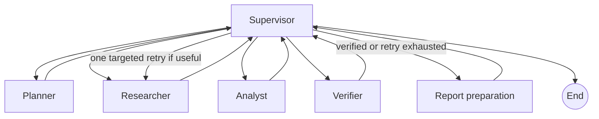

# Agentic research workflow

## Overview

`POST /api/v1/research/run` executes one research request through a compiled
LangGraph `StateGraph`. The graph coordinates the existing planner and retrieval
services with structured analyst, verifier, report-preparation, and supervisor
agents.



The supervisor uses deterministic conditional routing. The verifier can
request up to three targeted queries; the workflow runs at most one retry.
Repeated or already attempted queries are discarded. The graph has a bounded
LangGraph recursion limit as a final guard. Retry queries are normalized and
validated after punctuation is applied; queries that cannot fit the 500
character sub-question limit fail with a sanitized retry-query error.

The full run uses `RESEARCH_WORKFLOW_TIMEOUT`, defaulting to 300 seconds and
bounded to 600 seconds. A single monotonic deadline covers planning, every
retrieval and LLM stage, report preparation, and retry work. An expired stage
is recorded as a failed execution with `workflow_timeout` and routes directly
to graph termination; preceding execution history is retained.

## Agent responsibilities

- **Supervisor:** choose the next stage, enforce retry bounds, and set the final
  completed/partial/failed status.
- **Planner:** call `ResearchPlanner`, preserving its labeled deterministic
  fallback when the LLM is unavailable or returns invalid planning output.
- **Researcher:** call the existing retrieval service, deduplicate sources
  across a retry, and retain partial-search information.
- **Analyst:** use the configured LLM to produce schema-validated findings
  referencing only source IDs supplied to it.
- **Verifier:** assess each finding against the supplied search-result snippets,
  require a result for each finding, validate source references, and optionally
  recommend targeted follow-up searches.
- **Report preparation:** create deterministic report sections from supported
  and partially supported findings. Conflicting and unsupported claims are
  surfaced separately, not included in report sections. Per-finding citation
  mappings retain both the analyst's original references and verifier
  references.

Supported and partially supported verification classifications require at
least one unique source ID. Conflicting classifications require at least two
unique source IDs. Unsupported claims may have no source IDs but are explicitly
listed as unsupported. All references are checked against the retrieved
sources both during verification and report preparation.

LLM failures, incomplete generations, and invalid structured outputs fail the
current stage and are returned as sanitized workflow errors. Retrieval failures
also produce a failed workflow response. An empty evidence set can complete
the graph with `partial` status and an explicit report limitation.

The final status rules are:

- `completed`: all stages finished; retrieval was complete and no evidence gaps,
  partial support, unsupported claims, conflicts, or missing evidence remain.
- `partial`: stages finished but evidence is empty, partial, partially
  supported, unsupported, conflicting, or reports unresolved research gaps.
- `failed`: an essential agent stage failed, all initial queries failed, or the
  overall deadline expired. If a targeted retry fails after initial evidence
  exists, the workflow keeps that evidence, marks retrieval partial, and
  continues analysis.

Every query produces a diagnostic with original query, success, result count,
and sanitized error code/message. Successful results are retained when other
queries fail. Empty successful results are not provider errors. All-query
failure is distinct from partial retrieval.

## API

Send a validated `ResearchRequest` to `POST /api/v1/research/run`:

```json
{
  "question": "How is generative AI changing financial services?",
  "max_subquestions": 5
}
```

The response contains the research ID, status, plan, retrieved sources,
findings, verification, report, stage execution history, retry count, and any
sanitized errors. It also exposes attempted queries and whether retrieval was
partial, plus per-query `retrieval_diagnostics`. Workflow failures are
represented by `status: "failed"` in
the workflow response rather than returned as successful research results.
Input validation errors remain HTTP 422 responses.

Each execution records its stage, start/end timestamps, duration, status, and
retry count. Prompts, raw model output, and provider exception details are not
included in the response.

## Evidence and persistence boundaries

The analyst and verifier receive normalized search-result metadata and snippets;
the workflow does not fetch or crawl source pages. Verification is therefore a
model assessment of supplied snippets, not independent fact-checking, URL
validation beyond existing URL syntax checks, or publication verification.
Reports state these limitations.

Source fields are bounded: title 500 characters, snippet/description 4,000,
URL 2,048, source type 64, original query 500, and metadata up to 20
JSON-compatible entries and 4 KiB total. SearXNG titles/snippets exceeding
their limits are deterministically truncated and the affected fields are
recorded in `metadata.truncated_fields`. Overlong URLs and invalid metadata are
rejected rather than rewritten.

Workflow state is in-memory and scoped to a single invocation. There is no
checkpoint saver, durable history, or resume API. The graph uses the existing
LLM and search configuration; a live Ollama runtime and configured search
provider are required for an end-to-end successful run. Tests use mocked
providers.
